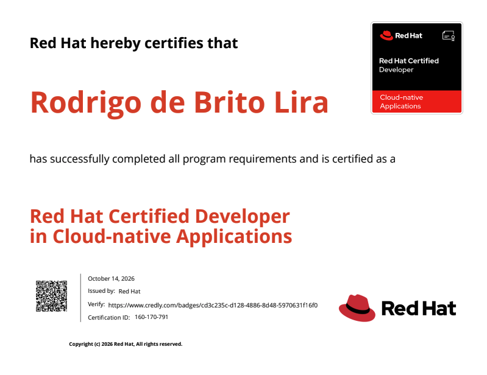

Salve Salve Pessoal!

Mais um passo importante na minha caminhada rumo ao **RHCA**, fui aprovado no exame **Red Hat Certified Developer in Cloud-native Applications (EX188)**! 

O exame foi baseado no **Red Hat 9.5** e **Podman 5** e cobrou conhecimentos sobre execução e gerenciamento de containers via linha de comando, criação de imagens com Containerfile e gerenciamento de aplicações utilizando Compose.

Para quem já trabalha com containers no dia a dia, acredito que não terá grandes dificuldades para realizar esse exame. Para ser franco, foi o exame mais simples que já fiz da Red Hat até agora!

Para quem está estudando para o EX188, minha principal recomendação é: estude bastante a documentação do Podman, do Podman Compose e do Containerfile. Você não precisa necessariamente utilizar um sistema Red Hat para se preparar. É possível estudar e praticar até mesmo no Windows, sem grandes dificuldades. O importante é conhecer bem as ferramentas e entender como utilizá-las na prática!

A prova tem 2 horas e 30 minutos de duração, tempo que considero suficiente para realizar as tarefas com tranquilidade, desde que você esteja bem preparado.

Boa sorte e até o próximo post!

🖖
