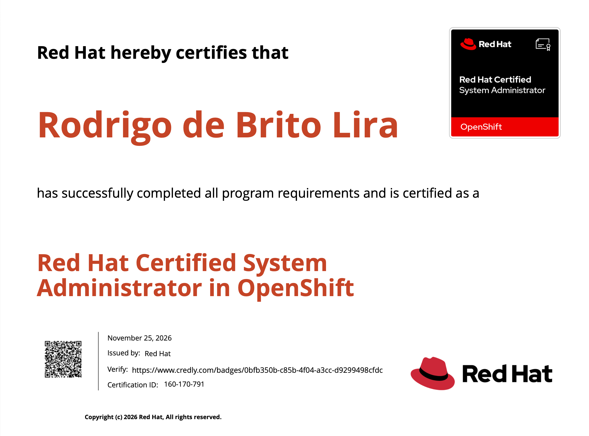

Salve, salve, pessoal!

Nesta semana, realizei mais um exame da Red Hat e, graças a Deus, fui aprovado no exame **Red Hat Certified System Administrator in OpenShift (EX280)**!

O exame foi baseado no **OpenShift 4.18** e avaliou conhecimentos relacionados à administração da plataforma de maneira geral, desde a configuração de diferentes objetos e recursos até a identificação e resolução de problemas (troubleshooting).

Mesmo para quem já trabalha com Kubernetes no dia a dia, acredito que não seja um exame tão trivial. Também não considero adequada uma comparação direta com o CKA (Certified Kubernetes Administrator), pois, apesar de o OpenShift ser baseado em Kubernetes, a plataforma possui diversas particularidades que exigem conhecimentos específicos.

Para quem está estudando para o EX280, minha principal recomendação é: estude bastante a documentação oficial e, se possível, faça o treinamento oficial da Red Hat.

Para os estudos por conta própria, você pode utilizar o OKD ou até mesmo o OpenShift Local, que pode ser instalado no Windows, macOS e Linux, desde que atendidos os requisitos de compatibilidade. O OpenShift Local disponibiliza um ambiente OpenShift de nó único, executado em uma máquina virtual, sendo uma boa alternativa para a realização de laboratórios.

Grande parte das tarefas solicitadas no exame pode ser realizada tanto pela **CLI (oc)** quanto pela interface **web (Web Console)**. Portanto, recomendo praticar bastante utilizando ambas as opções.

O exame tem três horas de duração. Concluí todas as questões faltando aproximadamente 15 minutos para o término e utilizei o tempo restante para revisar as configurações realizadas.

Apesar de ter concluído todas as questões, obtive uma pontuação de **233 pontos**, abaixo do que esperava. Por isso, recomendo atenção especial aos detalhes e à interpretação dos enunciados. Nem sempre os requisitos são apresentados de maneira explícita, sendo necessário interpretar o cenário e identificar a configuração adequada para atender ao que foi solicitado.

Além de saber configurar os recursos, é fundamental validar se as configurações realizadas realmente atendem aos requisitos de cada questão.

Boa sorte nos estudos e até o próximo post!

🖖
