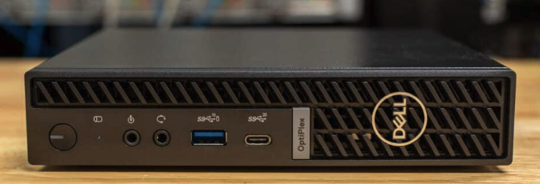
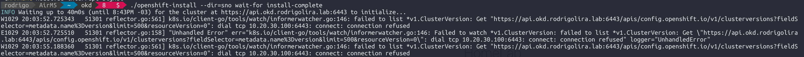
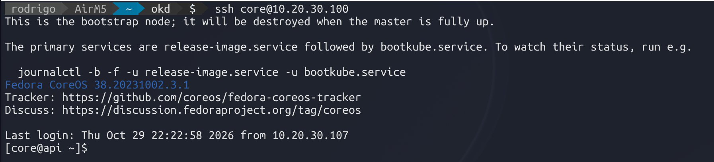
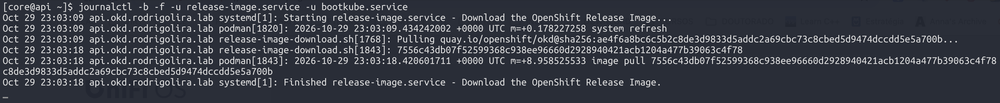
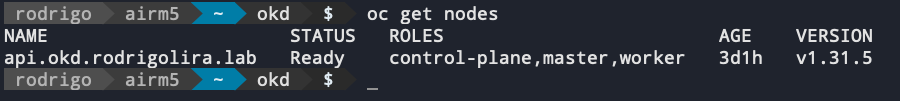
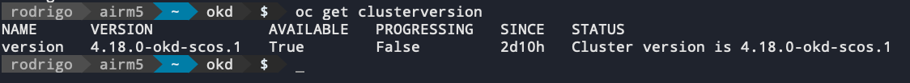
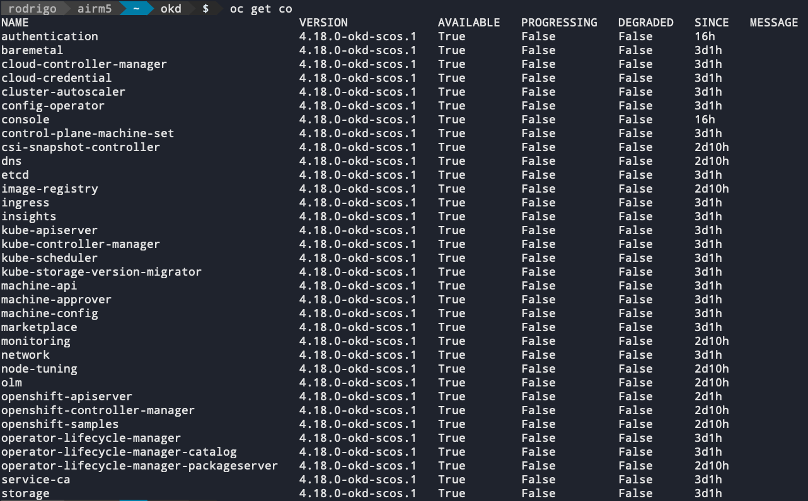
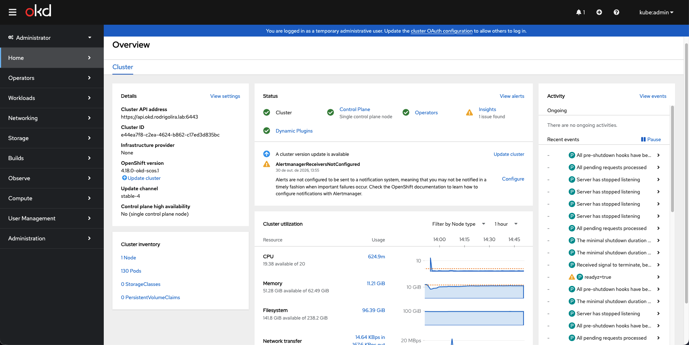

Salve Salve Pessoal!

Neste post, vou demonstrar como podemos instalar o **OKD** diretamente em uma única máquina física (**bare metal**). Essa instalação é chamada de **Single Node (SNO)**. Existem diversas maneiras de realizar a instalação do OKD. Porém, como uso apenas uma máquina em meu homelab, decidi fazer a instalação diretamente nela.

## Introdução

O **OKD** é uma distribuição do Kubernetes que serve como base de desenvolvimento para o Red Hat OpenShift. Ele oferece uma plataforma para implantação, gerenciamento e execução de aplicações em containers, integrando recursos como gerenciamento de workloads, redes, armazenamento, autenticação, operators e até máquinas virtuais.

Na arquitetura Single Node, um único servidor executa tanto os componentes do **Control Plane** quanto os **workloads das aplicações**. Essa configuração é interessante para laboratórios, ambientes de desenvolvimento e testes, mas não oferece alta disponibilidade.

## Meu homelab

A máquina que utilizo em meu homelab possui os seguintes recursos de hardware:

- Modelo: Dell OptiPlex Micro 7020
- Processador: Intel i5-14500T (até 4,8 GHz, 20 núcleos)
- Memória: 64 GiB DDR5 (2 módulos de 32 GB, 4800 MT/s)
- Armazenamento: NVMe SK hynix PVC10 de 512 GB e NVMe Lite-on de 256 GB.

[](images/homelab.png)

Estou instalando o OKD diretamente no disco NVMe Lite-on de 256 GB. O disco NVMe SK hynix PVC10 de 512 GB vou deixar para os volumes utilizados pelos pods e máquinas virtuais.

## Preparando o ambiente

Precisamos configurar os registros **DNS** que serão utilizados pelo OKD para a instalação. Segundo a documentação, os três são necessários.

Os registros DNS necessários são:

```text
api.okd.rodrigolira.lab                                       A   10.20.30.100
api-int.okd.rodrigolira.lab                                   A   10.20.30.100
*.apps.okd.rodrigolira.lab                                    A   10.20.30.100
```

Também devemos configurar o registro **PTR** correspondente. No meu firewall, quando crio uma entrada do tipo **A**, ele já cria o **PTR** automaticamente.

O domínio e os endereços utilizados devem ser substituídos pelos valores do seu ambiente.

**Importante:** o DNS precisa estar acessível durante toda a instalação. A resolução dos registros `api`, `api-int` e `*.apps` é fundamental para o funcionamento do cluster.

Também é necessário configurar o seu servidor **DHCP** para entregar o endereço IP correto. Normalmente, fazemos isso atrelando o endereço **MAC** ao **IP**.

## Criando a ISO de instalação do OKD

Em um Linux, vamos executar os seguintes passos para criar a ISO de instalação do OKD.

Primeiramente, definimos a versão do OKD e a arquitetura do servidor.

```bash
export OKD_VERSION="<VERSAO_COMPLETA_DO_RELEASE>"
export ARCH="x86_64"
export HOST_ARCH="$(uname -m)"
```

Não usei a mesma versão que está disponível na documentação; usei a versão `4.18.0-okd-scos.1`. Caso deseje, você pode selecionar outra na página oficial de releases do projeto:

https://github.com/okd-project/okd/releases

É importante utilizar os binários `oc` e `openshift-install` correspondentes ao mesmo release.

Download do cliente `oc`:

```bash
curl -fL \
  "https://github.com/okd-project/okd/releases/download/${OKD_VERSION}/openshift-client-linux-${OKD_VERSION}.tar.gz" \
  -o oc.tar.gz
```

Extraímos o arquivo:

```bash
tar -xzf oc.tar.gz
chmod +x oc
```

Download do `openshift-install`:

```bash
curl -fL \
  "https://github.com/okd-project/okd/releases/download/${OKD_VERSION}/openshift-install-linux-${OKD_VERSION}.tar.gz" \
  -o openshift-install-linux.tar.gz
```

Extraímos o instalador:

```bash
tar -xzf openshift-install-linux.tar.gz
chmod +x openshift-install
```

O Fedora CoreOS (FCOS) é o sistema operacional utilizado pelos nós do OKD. Para obter a URL da imagem compatível com o instalador, executamos:

```bash
export ISO_URL=$(./openshift-install coreos print-stream-json | grep location | grep $ARCH | grep iso | cut -d\" -f4)
```

Download da ISO do FCOS:

```bash
curl -fL "$ISO_URL" -o fcos-live.iso
```

## Configurações do cluster

O arquivo `install-config.yaml` define os parâmetros de instalação, incluindo domínio, rede, quantidade de nós, disco e credenciais.

Crie o arquivo:

```bash
vim install-config.yaml
```

Adicione o conteúdo:

```yaml
apiVersion: v1
baseDomain: rodrigolira.lab
compute:
- name: worker
  replicas: 0
controlPlane:
  name: master
  replicas: 1
metadata:
  name: okd
networking:
  clusterNetwork:
  - cidr: 10.128.0.0/14
    hostPrefix: 23
  machineNetwork:
  - cidr: 10.0.0.0/16
  networkType: OVNKubernetes
  serviceNetwork:
  - 172.30.0.0/16
platform:
  none: {}
bootstrapInPlace:
  installationDisk: /dev/<IDENTIFICADOR_DO_DISCO>
pullSecret: '<SECRET>'
sshKey: |
  <CHAVE_PUBLICA_SSH>

```

Os parâmetros que normalmente alteramos são:

- `baseDomain: rodrigolira.lab`: domínio base do seu cluster, substitua pelo domínio local.
- `metadata.name: okd`: o nome do seu cluster.
- `installationDisk: /dev/<DISCO>`: disco de destino da instalação.
- `pullSecret: '<SECRET>'`: secret de instalação.
- `sshKey: <CHAVE_PUBLICA_SSH>`: sua chave pública do SSH para acesso direto ao FCOS após a instalação.

Para identificar o disco de instalação, você pode rodar o FCOS antes e verificar como ele vai identificar os discos. O disco informado em `installationDisk` será utilizado para a instalação do sistema operacional.

Você pode gerar sua `secret` na URL abaixo:

https://console.redhat.com/openshift/install/pull-secret

## Gerando a configuração Ignition

Com o arquivo `install-config.yaml` preparado, vamos gerar os arquivos necessários para inicializar o cluster.

Crie o diretório de instalação:

```bash
mkdir -p sno
```

Copie o arquivo de configuração:

```bash
cp install-config.yaml sno/
```

Execute o instalador:

```bash
./openshift-install \
  --dir=sno \
  create single-node-ignition-config
```

O instalador gera os arquivos de configuração Ignition:

```text
sno/bootstrap-in-place-for-live-iso.ign
```

Esse arquivo contém as informações necessárias para inicializar o Fedora CoreOS e executar o processo de instalação do OKD.

## Incorporando o Ignition à imagem ISO

Agora precisamos incorporar o arquivo Ignition à imagem do Fedora CoreOS.

Utilizaremos o `coreos-installer` executado em um container Podman.

```bash
alias coreos-installer='podman run --privileged --pull always --rm \
      -v /dev:/dev -v /run/udev:/run/udev -v $PWD:/data -w /data \
      quay.io/coreos/coreos-installer:release'
```

```bash
coreos-installer iso ignition embed -fi sno/bootstrap-in-place-for-live-iso.ign fcos-live.iso
```

O parâmetro `-fi` permite substituir uma configuração Ignition já incorporada, caso exista.

Após a execução, a imagem `fcos-live.iso` estará preparada para inicializar a instalação do OKD Single Node.

Com a imagem ISO preparada, podemos iniciar a instalação no servidor físico. O instalador realizará a preparação do disco, a instalação do Fedora CoreOS e a configuração dos componentes do cluster. Durante esse processo, o servidor poderá reiniciar algumas vezes.

## Acompanhando a instalação

Podemos acompanhar o processo de instalação e configuração utilizando o `openshift-install`:

```bash
./openshift-install --dir=sno wait-for install-complete
```

[](images/okd-install.png)

Esse comando acompanha o progresso até a conclusão da instalação ou até ocorrer um erro ou timeout.

O tempo necessário depende do hardware, da conectividade e da velocidade de download das imagens.

Particularmente, prefiro acessar o servidor via SSH e acompanhar o processo de instalação por lá. O login deve ser feito usando a chave SSH que você usou no arquivo de configuração do cluster.

Como utilizei minha própria chave púbica, basta executar o comando:

```bash
ssh core@10.20.30.100
```

[](images/okd-install2.png)

Execute o comando informado após o login, dessa forma voê verá todo o log e poderá acompanhar tudo que está acontecendo:

```bash
journalctl -b -f -u release-image.service -u bootkube.service
```

[](images/okd-install3.png)

## Acessando o OKD via CLI

Após a conclusão, configure a variável `KUBECONFIG` para utilizar as credenciais administrativas geradas pelo instalador:

```bash
export KUBECONFIG="$PWD/sno/auth/kubeconfig"
```

Verifique os nós:

```bash
./oc get nodes -o wide
```

[](images/okd-install4.png)

Em uma instalação Single Node, esperamos encontrar apenas um nó com as funções `control-plane` e `worker`, no estado `Ready`.

Também podemos verificar a versão instalada:

```bash
./oc get clusterversion
```

[](images/okd-install5.png)

Podemos verificar todos os operadores do cluster:

```bash
./oc get clusteroperators
```

[](images/okd-install6.png)

O ideal é que os Cluster Operators estejam disponíveis e que não existam componentes essenciais apresentando falhas persistentes.

## Acessando o console web do OKD

O console administrativo web poderá ser acessado pelo endereço:

```text
https://console-openshift-console.apps.okd.rodrigolira.lab
```

As credenciais iniciais do usuário `kubeadmin` são armazenadas no diretório de instalação.

Você pode consultar a senha no arquivo:

```bash
cat sno/auth/kubeadmin-password
```

[](featured.png)

## Considerações finais

A instalação Single Node permite executar o OKD em um único servidor físico, reunindo os componentes do Control Plane e os workloads em uma mesma máquina.

Essa arquitetura é especialmente útil para homelabs, estudos de Kubernetes, testes de Operators e familiarização com a administração do OpenShift.

Sua principal limitação é a ausência de alta disponibilidade: uma falha ou manutenção no servidor pode tornar todo o cluster indisponível.

## Referências

- [OKD 4.22 — Installing OpenShift on a single node](https://docs.okd.io/4.22/installing/installing_sno/install-sno-installing-sno.html)
- [OKD — GitHub Releases](https://github.com/okd-project/okd/releases)

Boa sorte e até o próximo post!

🖖🖖🖖
