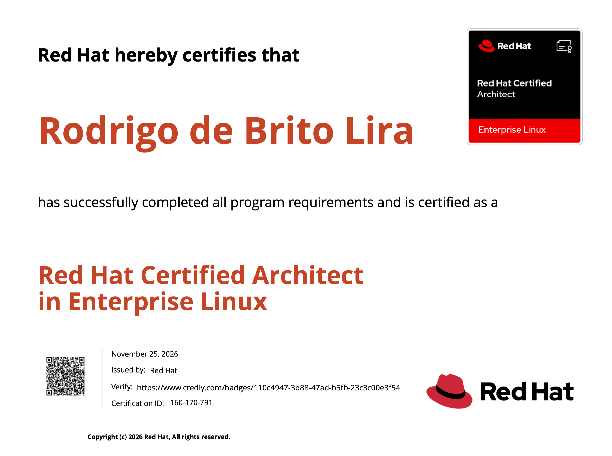

Salve, salve, pessoal!

Quem me acompanha aqui no blog sabe que estou sempre buscando me atualizar e realizar alguma certificação, principalmente aquelas voltadas para Linux e tecnologias relacionadas.

Desde que comecei minha jornada com as certificações da Red Hat, sempre tive um sonho: me tornar um **Red Hat Certified Architect (RHCA)**. Sabia que não seria uma tarefa fácil, tanto pela dificuldade dos exames quanto pelo investimento financeiro necessário ao longo dessa caminhada.

No meu último post, falei sobre o exame EX280, voltado para a administração do OpenShift. Além de conquistar mais uma certificação, essa aprovação teve um significado especial para mim, pois foi justamente a que faltava para alcançar o tão sonhado RHCA.

Uma das minhas principais metas para 2026 era me tornar um RHCA e, graças a Deus, depois de mais de 10 anos desde a minha primeira certificação Red Hat, finalmente consegui!

Quando comecei essa jornada, em 2016, a realidade era bem diferente da que temos atualmente. Antes da pandemia, precisava viajar para São Paulo para realizar os exames presenciais. Na maioria das vezes, fazia praticamente um bate-volta, tentando reduzir ao máximo os gastos com passagens aéreas, hospedagem, alimentação e deslocamento.

Além do valor do exame, precisava considerar todos esses custos, o que tornava cada tentativa um investimento ainda maior. Com a possibilidade de realizar os exames remotamente, esse processo se tornou muito mais acessível, principalmente para quem mora longe dos centros de aplicação das provas.

Ao longo desses anos, foram muitas horas de estudo, laboratórios, leitura de documentação, aprovações e, claro, algumas reprovações.

Resolvi compartilhar abaixo todo o meu histórico de exames da Red Hat, desde a minha primeira certificação, o RHCSA, em agosto de 2016, até a conquista do RHCA, em novembro de 2026.

Faço questão de compartilhar também as reprovações, pois elas fazem parte dessa trajetória. Nem sempre conseguimos alcançar o resultado esperado na primeira tentativa, e isso faz parte do processo de aprendizado.

| Data | Código | Exame | Pontuação | Resultado |
|---|---|---|---:|---|
| 15/08/2016 | EX200 | Red Hat Certified System Administrator (RHCSA) | 233 | ✅ Aprovado |
| 05/04/2018 | EX300 | Red Hat Certified Engineer (RHCE) | 68 | ❌ Reprovado |
| 18/02/2019 | EX300 | Red Hat Certified Engineer (RHCE) | 252 | ✅ Aprovado |
| 30/01/2020 | EX407 | Red Hat Certified Specialist in Ansible Automation | 178 | ❌ Reprovado |
| 30/09/2020 | PE180 | Red Hat Preliminary Exam in Containers, Kubernetes, and OpenShift | 221 | ✅ Aprovado |
| 12/10/2021 | EX294 | Red Hat Certified Engineer (RHCE) | 257 | ✅ Aprovado |
| 30/09/2024 | EX316 | Red Hat Certified Specialist in OpenShift Virtualization | 268 | ✅ Aprovado |
| 27/10/2025 | EX442 | Red Hat Certified Specialist in Linux Performance Tuning | 143 | ❌ Reprovado |
| 03/12/2025 | EX442 | Red Hat Certified Specialist in Linux Performance Tuning | 183 | ❌ Reprovado |
| 17/12/2025 | EX442 | Red Hat Certified Specialist in Linux Performance Tuning | 210 | ✅ Aprovado |
| 27/07/2026 | EX358 | Red Hat Certified Specialist in Services Management and Automation | 197 | ❌ Reprovado |
| 03/08/2026 | EX358 | Red Hat Certified Specialist in Services Management and Automation | 284 | ✅ Aprovado |
| 14/10/2026 | EX188 | Red Hat Certified Developer in Cloud-native Applications | 282 | ✅ Aprovado |
| 25/11/2026 | EX280 | Red Hat Certified OpenShift Administrator | 233 | ✅ Aprovado |

Ao todo, foram 14 exames realizados, 9 aprovações e 5 reprovações, distribuídos ao longo de pouco mais de 10 anos.

Como vocês podem observar na tabela, alguns exames exigiram mais de uma tentativa. Um bom exemplo foi o EX442, voltado para Linux Performance Tuning, no qual fui reprovado duas vezes antes de conseguir a aprovação na terceira tentativa.

É claro que ninguém gosta de ser reprovado, principalmente considerando o valor dos exames, mas é importante identificar os pontos em que precisamos melhorar, voltar aos estudos e tentar novamente.

Os exames da Red Hat não são baratos, principalmente considerando o poder de compra que temos aqui no Brasil. Entretanto, na minha opinião, é um investimento que vale a pena, não apenas pela certificação em si, mas principalmente pelo conhecimento adquirido durante a preparação para cada exame.

Uma das coisas que mais gosto nas certificações da Red Hat é o fato de seus exames serem práticos. Não basta conhecer a teoria ou memorizar comandos, é necessário saber configurar, administrar e solucionar problemas nos ambientes apresentados durante a prova.

O conhecimento adquirido ao longo dessa jornada vai muito além dos exames e pode ser aplicado em diversas situações do nosso dia a dia profissional.

Para quem está iniciando sua caminhada no mundo das certificações ou também tem o objetivo de se tornar um RHCA, minha recomendação é estudar bastante, montar seus próprios laboratórios, consultar a documentação oficial e, principalmente, não desanimar diante das reprovações.

Cada pessoa tem seu próprio ritmo, suas responsabilidades, sua disponibilidade de tempo e suas condições financeiras. Não existe a necessidade de conquistar todas as certificações em um curto período. Minha própria trajetória é um exemplo disso.

Hoje, olhando para trás, desde aquele primeiro exame em 2016, passando pelas viagens para São Paulo, pelas reprovações e por todas as horas dedicadas aos estudos, posso dizer que valeu a pena.

Conquistar o RHCA é a realização de um sonho e uma das maiores conquistas da minha trajetória profissional. Isso não significa que os estudos acabaram, muito pelo contrário, ainda tenho muito o que aprender e muitas tecnologias para explorar.

Que venham os próximos desafios!

Boa sorte nos estudos e até o próximo post!

🖖
